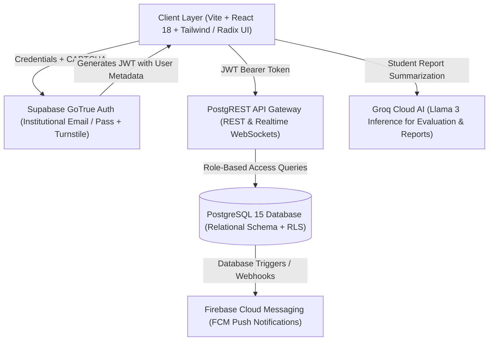
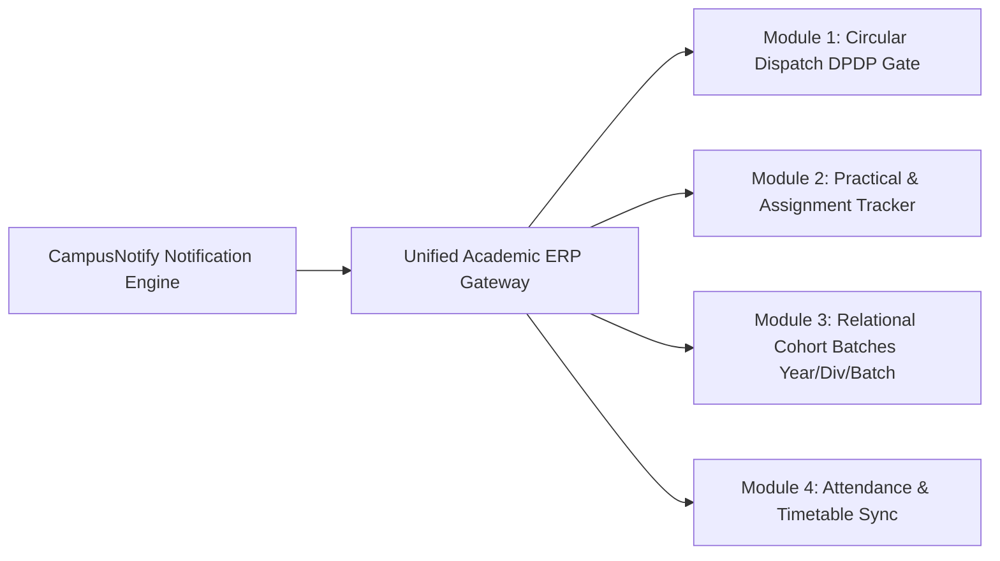

# 🏛️ AcadFlow Deep Architecture & Database Reverse-Engineering Blueprint
> **System Architecture & Database Specification for CampusNotify Enterprise Integration**  
> **Prepared for:** Pratik Atpadkar (@ATP0925) | PVPPCOE Information Technology

---

## 1. 🌐 High-Level System Architecture Overview

AcadFlow operates on a **Modern Hybrid Serverless + Decoupled PostgreSQL Model**:



---

## 2. 🗄️ Reverse-Engineered PostgreSQL Database Schema

AcadFlow uses a relational database hosted on Supabase (`hyyevrdgvoekdkdvbmix.supabase.co`). Below is the complete SQL schema with tables, foreign keys, and column types:

### Table 1: `departments` (Institutional Faculties)
```sql
CREATE TABLE departments (
    id UUID PRIMARY KEY DEFAULT gen_random_uuid(),
    name VARCHAR(100) NOT NULL, -- e.g., 'Information Technology'
    code VARCHAR(10) NOT NULL UNIQUE, -- e.g., 'IT', 'COMPS'
    features JSONB DEFAULT '{}'::jsonb, -- Module toggles (attendance, mentor, feedback)
    created_at TIMESTAMPTZ DEFAULT NOW()
);
```

### Table 2: `profiles` (Unified User Master with RBAC)
```sql
CREATE TABLE profiles (
    id UUID PRIMARY KEY REFERENCES auth.users(id) ON DELETE CASCADE,
    name VARCHAR(150) NOT NULL,
    email VARCHAR(150) NOT NULL UNIQUE,
    role VARCHAR(20) NOT NULL CHECK (role IN ('student', 'faculty', 'hod', 'mentor', 'parent', 'admin')),
    department_id UUID REFERENCES departments(id),
    department VARCHAR(100),
    year INT CHECK (year BETWEEN 1 AND 4), -- 1: FE, 2: SE, 3: TE, 4: BE
    division VARCHAR(5), -- 'A', 'B', 'C'
    batch VARCHAR(5), -- 'C', 'Batch C'
    enrollment_number VARCHAR(30) UNIQUE, -- 'VU4F2526072'
    ward_enrollment_number VARCHAR(30), -- For 'parent' role
    phone VARCHAR(20),
    fcm_device_token TEXT, -- For real-time mobile push alerts
    groq_api_key TEXT, -- User-custom AI keys if configured
    created_at TIMESTAMPTZ DEFAULT NOW(),
    updated_at TIMESTAMPTZ DEFAULT NOW()
);
```

### Table 3: `batches` (Classroom & Lab Cohorts)
```sql
CREATE TABLE batches (
    id UUID PRIMARY KEY DEFAULT gen_random_uuid(),
    name VARCHAR(100) NOT NULL, -- e.g. 'SQL(C)-PM', 'SEIT A Batch C ED Lab'
    department_id UUID REFERENCES departments(id) ON DELETE CASCADE,
    academic_year VARCHAR(15) DEFAULT '2025-26',
    year INT NOT NULL,
    division VARCHAR(5) NOT NULL,
    batch VARCHAR(10) NOT NULL, -- 'C' or 'All'
    created_by UUID REFERENCES profiles(id), -- Faculty / Instructor
    subject_id UUID,
    created_at TIMESTAMPTZ DEFAULT NOW()
);
```

### Table 4: `batch_students` (Enrollment Roster)
```sql
CREATE TABLE batch_students (
    id UUID PRIMARY KEY DEFAULT gen_random_uuid(),
    batch_id UUID REFERENCES batches(id) ON DELETE CASCADE,
    student_id UUID REFERENCES profiles(id) ON DELETE CASCADE,
    enrolled_at TIMESTAMPTZ DEFAULT NOW(),
    UNIQUE(batch_id, student_id)
);
```

### Table 5: `batch_practicals` & `assignments` (Coursework Definitions)
```sql
CREATE TABLE assignments (
    id UUID PRIMARY KEY DEFAULT gen_random_uuid(),
    batch_id UUID REFERENCES batches(id) ON DELETE CASCADE,
    title VARCHAR(255) NOT NULL,
    description TEXT,
    due_date TIMESTAMPTZ NOT NULL,
    target_division VARCHAR(5),
    target_batch VARCHAR(10),
    created_by UUID REFERENCES profiles(id),
    created_at TIMESTAMPTZ DEFAULT NOW()
);

CREATE TABLE batch_practicals (
    id UUID PRIMARY KEY DEFAULT gen_random_uuid(),
    batch_id UUID REFERENCES batches(id) ON DELETE CASCADE,
    practical_no INT NOT NULL,
    title VARCHAR(255) NOT NULL,
    description TEXT,
    due_date TIMESTAMPTZ,
    created_at TIMESTAMPTZ DEFAULT NOW()
);
```

### Table 6: `submissions` (Core Evaluation Engine)
```sql
CREATE TABLE submissions (
    id UUID PRIMARY KEY DEFAULT gen_random_uuid(),
    student_id UUID REFERENCES profiles(id) ON DELETE CASCADE,
    assignment_id UUID REFERENCES assignments(id) ON DELETE CASCADE,
    practical_id UUID REFERENCES batch_practicals(id) ON DELETE CASCADE,
    status VARCHAR(20) NOT NULL DEFAULT 'submitted' CHECK (status IN ('submitted', 'evaluated', 'resubmit')),
    marks NUMERIC(5,2), -- e.g. 8.5 / 10
    max_marks NUMERIC(5,2) DEFAULT 10.0,
    feedback TEXT,
    report_url TEXT, -- Cloud PDF / Blob URL
    submitted_at TIMESTAMPTZ DEFAULT NOW(),
    evaluated_at TIMESTAMPTZ,
    evaluated_by UUID REFERENCES profiles(id),
    CHECK (assignment_id IS NOT NULL OR practical_id IS NOT NULL)
);
```

### Table 7: `attendance_timetable` & Tracking
```sql
CREATE TABLE attendance_timetable (
    id UUID PRIMARY KEY DEFAULT gen_random_uuid(),
    teacher_id UUID REFERENCES profiles(id),
    subject_name VARCHAR(100) NOT NULL,
    lecture_type VARCHAR(20) CHECK (lecture_type IN ('theory', 'practical', 'tutorial')),
    target_category VARCHAR(20), -- 'division' or 'batch'
    target_value VARCHAR(10), -- 'A', 'C'
    date DATE NOT NULL DEFAULT CURRENT_DATE,
    slot VARCHAR(30) NOT NULL, -- '09:00 - 10:00'
    created_at TIMESTAMPTZ DEFAULT NOW()
);
```

### Table 8: `hod_messages` (Institutional Circulars & Notices)
```sql
CREATE TABLE hod_messages (
    id UUID PRIMARY KEY DEFAULT gen_random_uuid(),
    subject VARCHAR(255) NOT NULL,
    content TEXT NOT NULL,
    author_id UUID REFERENCES profiles(id),
    target_departments UUID[] DEFAULT '{}',
    target_years INT[] DEFAULT '{}',
    status VARCHAR(20) DEFAULT 'published' CHECK (status IN ('draft', 'published', 'archived')),
    created_at TIMESTAMPTZ DEFAULT NOW()
);
```

---

## 3. 🧠 Core Business Logic & Workflows

### A. Role-Based Access Control (RBAC) Hierarchy
1. **Student:** Access only enrolled batches (`batch_students`), read assignments, upload submissions, view evaluated marks and personal attendance.
2. **Faculty:** Create practicals/assignments, evaluate submissions (`UPDATE marks, feedback`), mark lecture attendance, view batch analytics.
3. **HOD:** Broadcast `hod_messages` (circulars), review faculty performance metrics, manage department batches.
4. **Mentor / Parent:** View ward's attendance percentage, submission completion rate, and mentor meeting cards.

### B. Master Report Auto-Generation Pipeline
* When all practicals (e.g. 47/47) are submitted, the system queries:
  ```sql
  SELECT S.status, S.marks, P.practical_no, P.title, B.name AS batch_name
  FROM submissions S
  JOIN batch_practicals P ON S.practical_id = P.id
  JOIN batches B ON P.batch_id = B.id
  WHERE S.student_id = :current_user_id;
  ```
* Aggregates completion percentage, generates an official PDF Master Report with institutional letterhead and cryptographic hash verification.

---

## 4. 🚀 Implementation Plan: Integrating into CampusNotify

CampusNotify currently has:
* Java Enterprise Core (`Notification.java`, `NotificationManager.java`, `User.java`)
* Google Cloud Firestore / Firebase Web Portal

### Direct Upgrade Strategy for CampusNotify:



1. **Step 1: Expand Java Model Classes (`src/`):**
   * Add `Batch.java` (Classroom container with Division and Batch attributes).
   * Add `Submission.java` (Marks, status, feedback, practical ID).
   * Add `AcademicReport.java` (Master completion calculator).
2. **Step 2: Database Migration:**
   * Provide dual-backend compatibility: Either PostgreSQL via Supabase or Firestore collection architecture mirroring these exact relational foreign keys.
3. **Step 3: Frontend Tab Enhancement (`index.html` & `app.js`):**
   * Add **"Practicals & Submissions"** and **"Batch Workspaces"** alongside the existing Circular Dispatch feed.

