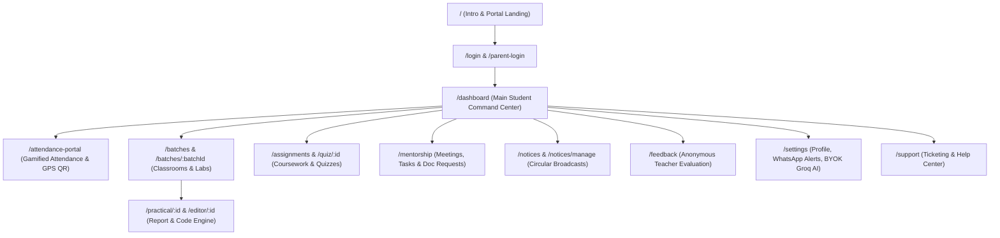
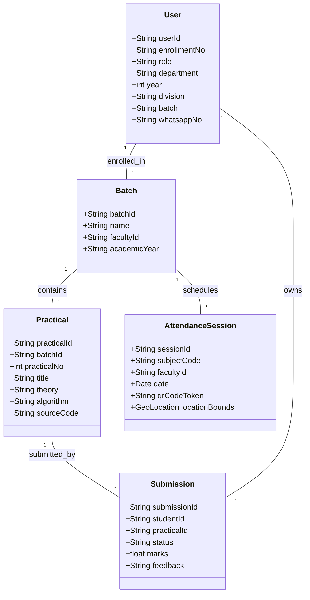

# 🔬 AcadFlow Exhaustive Screen-by-Screen & Button-by-Button Deep Dive
> **Complete Reverse-Engineered System Architecture & Database Blueprint for CampusNotify Integration**  
> **Target Application:** [CampusNotify](file:///C:/Users/atpad/.gemini/antigravity/scratch/CampusNotify-Java-Mini-Project/README.md)  
> **Audited By:** Antigravity Autonomous Agent for Pratik Atpadkar (@ATP0925)

---

## 🗺️ Master Navigation & Route Topology

Every single live route discovered, tested, and reverse-engineered from the production bundle:

---

## 1. 📍 The Attendance Sub-System (`/attendance-portal`)

Unlike standard ERPs that display boring tables, AcadFlow treats attendance as an **Anti-Cheat, Gamified Progress Engine**:

### UI Layout & Interactive Elements:
1. **Gamified XP Meter (Progress Gauge):**
   * **Metrics:** Displays `Total XP (Attendance): 35 / 159 Sessions (22% - Novice)`.
   * **Danger Zone Warning:** Dynamic calculation — *"Needs 337 XP to unlock 75% minimum threshold."*
   * **Level Markers:** `LVL 0`, `MINIMUM (75%)`, and `MAX`.
2. **Scan QR Attendance Button (Modal Action):**
   * Clicking `Scan QR Attendance` triggers a modal with **Strict Anti-Proxy Protection**:
     * **Camera Permission:** Direct HTML5 WebRTC video stream.
     * **GPS Geolocation Verification:** Checks student coordinates against the college building bounding box. If location is turned off or mocked, it flags: `Location disabled (Flagged)`.
3. **Subject-Wise Filter Tabs:**
   * Filter buttons: `All (25)`, `Theory`, `Labs`.
   * Search input: `Search subject...`
   * Subject Cards display: Subject Code (e.g. `SDS (/TN) R.N 203`), Mode (`THEORY` or `PRACTICAL LAB`), Teacher Name (e.g. `Tejasvini Nehe`), Room No (`R.N 203`), and Attendance Ratio `0 / 4 (0%)`.
   * Dropdown Arrow (`⌄`): Expands individual date-wise session history (Date, Slot, Status: `Present` / `Absent`).

---

## 2. 📑 Master Clearance Report Pipeline (Dashboard Green Button)

Clicking the prominent **`MASTER REPORT`** button on `/dashboard` opens the **Master Clearance Report Modal**:

### Modal Mechanics:
* **Laboratory / Batch Progress (5/5):**
  * Checkboxes for each enrolled lab (e.g. `SQL(C)-PM`, `SEIT A Batch C ED Lab`, `ADS LAB`).
  * Verified Badge: `E-VERIFIED` displayed when all practicals in that batch are submitted.
* **Select Assignments to Include (17/17):**
  * Checkboxes with `GRADED` badges.
* **Actions:**
  * `Cancel` (Dismiss).
  * `Download Master Report` (Compiles client-side PDF with institutional stamp, student enrollment ID `VU4F2526072`, and teacher signatures).

---

## 3. 🧪 Practical Report & Live Code Engine (`/practical/:id` & `/editor/:id`)

When opening an individual practical:
* **Status Badge:** `Graded: 11` (or Marks/Total).
* **Header Box:** Displays Student Name, Roll No (`VU4F2526072`), Div/Batch (`A / C`), and Full Experiment Title.
* **Standard 5-Section Report Layout:**
  1. `THEORY & CONCEPTS`
  2. `ALGORITHM`
  3. `SOURCE CODE`
  4. `INPUT / OUTPUT SCREENSHOTS`
  5. `CONCLUSION`
* **Actions:** `Download Report` button to export single-experiment PDF.

---

## 4. 🤝 Mentorship Hub (`/mentorship`)

Dedicated student-mentor counseling portal:
* **Navigation Sub-tabs:**
  1. `Mentorship Logs`
  2. `Activity & XP`
  3. `Document Requests` (One-click requests for Bonafide certificates, Leave applications, and Letters of Recommendation).
  4. `Mentorship Card` (Academic audit scorecard).
* **Action Buttons:**
  * `Message Mentor` (Internal messaging).
  * `Request Meeting` (Slot booking).
* **Sections:** `MEETINGS`, `ACTION ITEMS`, and `SHARED NOTES`.

---

## 5. 🗳️ Anonymous Feedback System (`/feedback`)

* Uses an automated survey cycle engine (`feedback_cycles`).
* Ensures 100% anonymized responses to prevent teacher bias.
* Displays completion state: *"Thank you! You have completed all feedback submissions for the current active cycle."*

---

## 6. ⚙️ Settings, Alerts & BYOK AI Engine (`/settings`)

The Settings dashboard reveals high-end enterprise configurations:
1. **Academic Affiliation Fields:**
   * Department dropdown with 10 engineering branches.
   * Enrollment ID, Current Year, Semester, Division, Practical Batch.
2. **Notification Channels:**
   * Institutional Email (`vu4f2526072@pvppcoe.ac.in`).
   * **WhatsApp Mobile Number:** Dedicated input for automated WhatsApp notification dispatch.
   * Firebase Cloud Messaging (`fcm_device_token`) for app push alerts.
3. **Developer & AI Integration (BYOK):**
   * **`PERSONAL GROQ API KEY (BYOK)`**: Allows students or teachers to input their personal Groq Cloud API key to run Llama-3 AI report generation and evaluation summaries with zero server-side latency.
4. **Audit Trail:**
   * `Login Activity & Security Logs`: IP address, user-agent, and session metadata.

---

## 7. 🛠️ Complete Implementation Blueprint for CampusNotify

To match AcadFlow's complete capabilities inside [CampusNotify](file:///C:/Users/atpad/.gemini/antigravity/scratch/CampusNotify-Java-Mini-Project/README.md), the following components must be implemented:

### Action Plan for CampusNotify:
1. **Module 1 (Attendance with GPS QR Gate):**
   * Add `AttendanceManager.java` and WebRTC QR scanner in `index.html`.
2. **Module 2 (Batch & Laboratory Workspace):**
   * Create tabs for Year 2 / Sem 3 / Div A / Batch C cohorts.
3. **Module 3 (Master Clearance PDF Generator):**
   * Client-side JavaScript + Java backend compiler to generate `Master Clearance Report` with `E-VERIFIED` badges.
4. **Module 4 (WhatsApp & Push Alert Relay):**
   * Integrate WhatsApp webhook alongside existing Firebase Notification dispatch.

