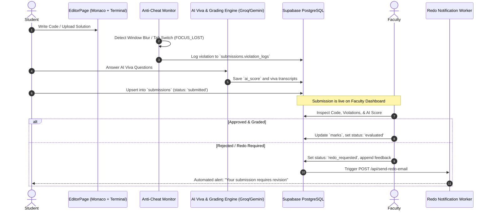

# 🚀 ACADFLOW COMPLETE SUBMISSION & FACULTY ARCHITECTURE
> **CampusNotify Reverse-Engineering Specification**  
> **Source Inspection:** `SubmissionListModal-EizUiU38.js`, `BulkGradingModal-DxsG4LUs.js`, `Assignments-CxhzwzgR.js`, `EditorPage-C3az92yb.js`, `attendanceServices-DaAsnt1W.js`

---

## 1. System Overview: Student Submission Engine



---

## 2. Student Submission Lifecycle & Schema

### Database Schema: `submissions`
| Column Name | Type | Description |
|---|---|---|
| `id` | `UUID PK` | Unique submission identifier |
| `student_id` | `UUID FK -> profiles.id` | The student submitting |
| `assignment_id` | `UUID FK -> assignments.id` | Nullable (if assignment) |
| `practical_id` | `UUID FK -> batch_practicals.id` | Nullable (if practical) |
| `content` | `TEXT / JSON` | Code text, Monaco buffer, or Supabase Storage PDF URL |
| `status` | `VARCHAR(30)` | `'not_submitted'` (virtual) -> `'submitted'` -> `'evaluated'` OR `'redo_requested'` |
| `marks` | `NUMERIC(5,2)` | Assigned marks (e.g. 9.5 / 10.0) |
| `ai_score` | `NUMERIC(5,2)` | Automated AI evaluation score |
| `violation_logs` | `JSONB` | Array of anti-cheat telemetry: `[{type: "FOCUS_LOST", timestamp: "..."}]` |
| `feedback` | `TEXT` | Faculty notes, rejection reason, or revision instructions |
| `grader_id` | `UUID FK -> profiles.id` | Faculty member who evaluated the submission |
| `submitted_at` | `TIMESTAMP` | Submission timestamp (checked against `due_date` for `LATE` flag) |

---

## 3. How Faculties Handle Responses on Desktop

Faculty interaction centers around **three major modules**:

### A. `SubmissionListModal` (Review & Evaluation Roster)
When a faculty opens an assignment or practical for their batch:
1. **Batch Synthesis**: Queries `batch_students` joined with `profiles`. If any student has no row in `submissions`, the UI synthesizes a `missing-${student.id}` item with status `not_submitted`.
2. **Filter Tabs**:
   - `All Status` (Entire batch)
   - `Pending Review` (Only `status === 'submitted'`)
   - `Graded` (Only `status === 'evaluated'`)
   - `Redo Requested` (Only `status === 'redo_requested'`)
3. **Student Card View**:
   - Displays Student Name, Roll No (`VU4F...`), Submission Date.
   - Shows **`LATE`** badge if `submitted_at > due_date`.
   - **Proctoring Flag**: Shows tab switch count from `violation_logs`.
   - **AI Score Badge**: Quick summary from the AI Viva bot.
4. **Faculty Actions**:
   - **Open Code / Document**: Loads student submission into Monaco viewer or embedded PDF preview.
   - **Grade (Marks Input)**: Faculty enters score (e.g., `8.5 / 10.0`). Sets `status = 'evaluated'`.
   - **Redo Request (Reject)**: Faculty enters required changes. Updates DB:
     ```javascript
     await supabase.from("submissions").update({
       status: "redo_requested",
       feedback: reason,
       marks: null,
       ai_score: null,
       grader_id: facultyUser.id
     }).eq("id", submission.id);
     
     // Automated Email Alert
     await fetch("/api/send-redo-email", {
       method: "POST",
       body: JSON.stringify({ studentEmail, subjectTitle, reason })
     });
     ```

### B. `BulkGradingModal` (Batch-Wide Fast Evaluation)
- Enables faculties to grade an entire batch of 30+ students simultaneously:
  - Filter by `Pending Submissions Only`.
  - Batch set default marks (e.g. Give 10/10 to all on-time submitters).
  - Adopt `ai_score` as default marks.

### C. `FacultyAttendanceOverview` (Session & Lecture Manager)
- **Live QR Code Generator**: Rotates a dynamic TOTP hash every 10 seconds via `attendance_session_secrets`.
- **Geofence Enforcement**: Students scanning the QR must match college latitude/longitude boundaries.
- **Manual Attendance Overrides**: Faculty can view the live roster and manually flip any student between Present / Absent.
- **`swap_requests` Table**: Allows faculty to trade lecture slots with colleagues if absent.

---

## 4. Implementation Plan for CampusNotify (Java Backend)

In our Java project (`c:\Users\atpad\.gemini\antigravity\scratch\CampusNotify-Java-Mini-Project\`), we will implement:

1. **Entities**:
   - `Submission.java` (with `status`, `marks`, `violationLogs`, `aiScore`, `feedback`).
   - `Task.java` (abstract base for Practical and Assignment).
   - `AttendanceSession.java` & `AttendanceRecord.java`.
2. **REST Endpoints**:
   - `POST /api/submissions/upload` — Student submit endpoint with proctoring payload.
   - `GET /api/faculty/tasks/{id}/submissions` — Roster with virtual unsubmitted entries.
   - `POST /api/faculty/submissions/{id}/grade` — Single grading.
   - `POST /api/faculty/submissions/bulk-grade` — Batch grading.
   - `POST /api/faculty/submissions/{id}/redo` — Redo request + triggers JavaMailSender email.
3. **Anti-Cheat Logger**:
   - Endpoint `POST /api/submissions/{id}/log-violation` to record focus loss.

