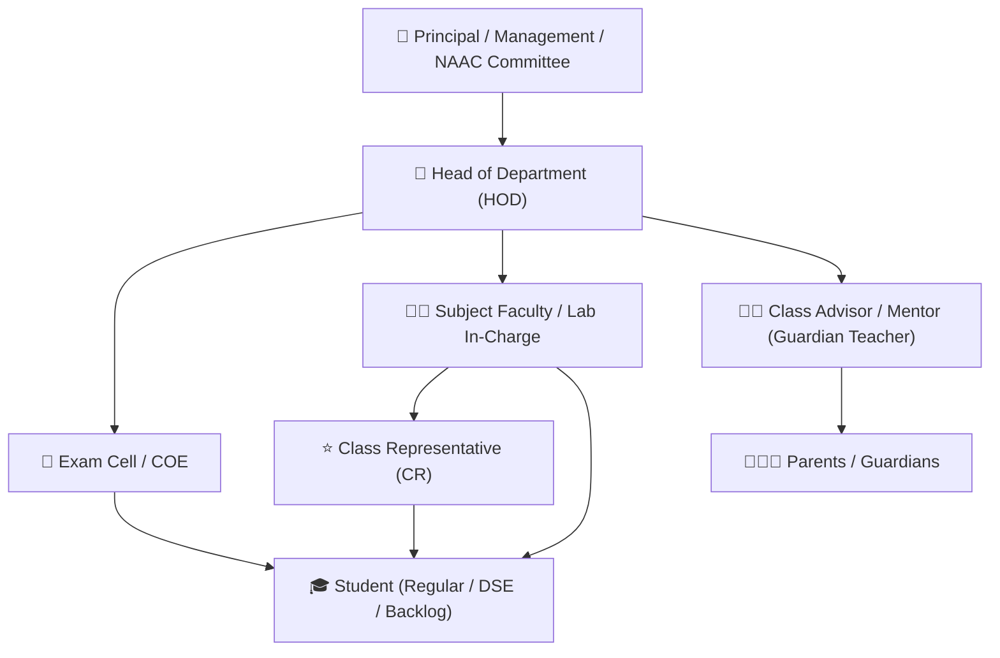
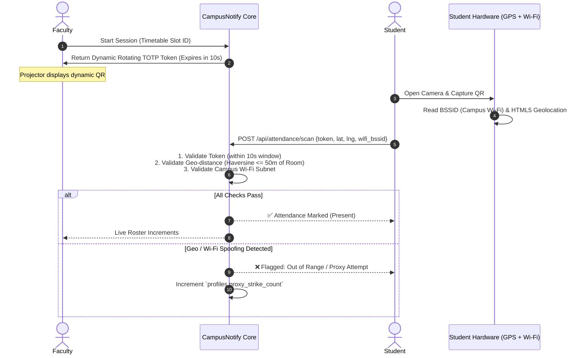
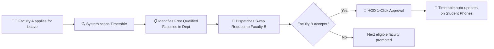
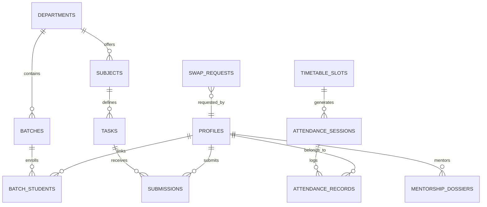

# 🏛️ CAMPUSNOTIFY: 360° ENTERPRISE ENGINEERING COLLEGE ECOSYSTEM
> **Comprehensive System Blueprint & Business Logic Engine**  
> **Target Environment:** Mumbai University Affiliated Engineering Colleges (e.g., PVPPCOE IT)  
> **Architectural Level:** Enterprise Production-Ready (Java Spring Boot 3 + PostgreSQL + WebSocket + Cloud Messaging)

---

## 1. The 7 Stakeholder Archetypes & RBAC Matrix

| Role | Permissions & Capabilities | Key Deliverables & Responsibilities |
|---|---|---|
| **Student** | View timetable, scan QR attendance, code in Monaco IDE, submit assignments/practicals, take AI viva, track marks & defaulter status, apply for leave. | Submissions, attendance compliance ($\ge 75\%$), fee clearances. |
| **Faculty** | Conduct attendance sessions, rotate QR codes, manage practicals/assignments, grade submissions, request redos, initiate lecture swaps, enter IA marks. | Course delivery, continuous assessment, timely evaluation. |
| **Mentor / Class Advisor** | Access 360° mentee dossiers (attendance, backlogs, fees, family contact), log counseling sessions, process medical leave, issue parent warning letters. | Guardian teacher care, parent communication, defaulter intervention. |
| **Head of Department (HOD)** | Department timetable approval, faculty workload balancer, syllabus progress monitor, lecture swap approval, final defaulter sign-off, NAAC dossier export. | Department governance, academic standards, resource allocation. |
| **Exam Cell / COE** | Internal Assessment (IA-1, IA-2) exam scheduling, room allocations, marks collation, Hall Ticket clearance lock, ATKT/KT eligibility audit. | Exam integrity, grade sheets, university mark uploads. |
| **Parent / Guardian** | Read-only portal + automated WhatsApp/SMS alerts for absent sessions, bi-monthly defaulter reports, mentor meeting requests. | Accountability, home intervention before university debarment. |
| **Principal / Management** | College-wide executive dashboards, cross-department compliance, faculty feedback metrics, NAAC/NBA criteria analytics. | Institutional strategy, accreditation compliance. |

---

## 2. Core Subsystem 1: Attendance, Biometric/QR & The Defaulter Machine

### A. Anti-Proxy Dynamic QR Protocol
To prevent proxy attendance (e.g. students forwarding screenshots or GPS spoofing):

### B. Defaulter Classification Pipeline (The 3-Tier Alert Engine)
Mumbai University strictly mandates **75% overall attendance** and recommends **75% per subject**.

$$\text{Attendance \%} = \left( \frac{\text{Conducted Sessions Attended}}{\text{Total Conducted Sessions}} \right) \times 100$$

CampusNotify implements an automated **Continuous Defaulter Pipeline**:
1. **D1 (30-Day Checkpoint)**: If attendance $< 75\%$, automatic in-app warning sent to student and mentor notified.
2. **D2 (Mid-Term Checkpoint / 60-Day)**: If attendance $< 75\%$, formal warning generated; system dispatches automated **WhatsApp/SMS notification to Parents** with exact missed session logs.
3. **D3 (Final Debarment / 90-Day)**:
   - If $< 75\%$, student is placed on the **Official Defaulter List**.
   - **Exam Cell Integration**: System automatically **locks Exam Hall Ticket** and blocks submission of final Term Work marks until an **Undertaking Form** signed by HOD and Parent is uploaded.

---

## 3. Core Subsystem 2: Term Work (TW) & Continuous Internal Evaluation (CIE)

### Mumbai University Formula Implementation
In standard engineering curricula, Term Work (TW) is typically out of **25 Marks** per subject. CampusNotify automates this calculation without manual faculty spreadsheets:

$$\mathbf{TW_{\text{Total}} (25M)} = \mathbf{M_{\text{Attendance}}} (5M) + \mathbf{M_{\text{Lab Experiments}}} (15M) + \mathbf{M_{\text{Mini Project/Viva}}} (5M)$$

#### 1. Attendance Scale ($M_{\text{Attendance}}$):
$$\begin{cases} 
\ge 90\% & \implies 5\text{ Marks} \\
85\% - 89.9\% & \implies 4\text{ Marks} \\
80\% - 84.9\% & \implies 3\text{ Marks} \\
75\% - 79.9\% & \implies 2\text{ Marks} \\
< 75\% & \implies 0\text{ Marks (Flagged Defaulter)}
\end{cases}$$

#### 2. Lab Experiments Continuous Rubric ($M_{\text{Lab Experiments}}$):
For every practical (e.g. 10 practicals throughout the semester, 15 marks converted):
- **Timely Submission (2M)**: Submitted on or before deadline.
- **Code Execution & Logic (5M)**: Clean compilation, passed test cases, proper comments.
- **Lab Performance & Viva (3M)**: Questions asked during lab session.
- $\text{Experiment Score} = \frac{\sum \text{Practical Marks}}{\text{Total Practicals}} \times 1.5$

---

## 4. Core Subsystem 3: Faculty Lecture Swap & Substitution Engine

When a faculty member is sick or on emergency duty:

---

## 5. Core Subsystem 4: NBA / NAAC Accreditation Auto-Dossier Generator
The most exhausting job for college professors is manual Course Outcomes (CO) and Program Outcomes (PO) mapping. CampusNotify automates this completely:

1. **CO-PO Mapping Matrix**:
   - Every assignment, practical, and IA question is tagged with a target Course Outcome (e.g., `CO1: Understand B-Trees`, `CO2: Analyze Indexing Latency`).
2. **Direct Attainment Calculation**:
   - System calculates what percentage of students scored $\ge 60\%$ in questions mapped to `CO1`.
   - Generates the official **NBA Direct Attainment Table** automatically.
3. **1-Click Audit Dossier**:
   - Generates audit-ready PDF course files with syllabus coverage, question papers, sample best/average/weak student papers, attendance registers, and marksheets.

---

## 6. Complete Production Database Entity-Relationship Architecture

---

## 7. CampusNotify Java Backend Implementation Strategy

To execute this architecture cleanly inside `c:\Users\atpad\.gemini\antigravity\scratch\CampusNotify-Java-Mini-Project\`:

1. **`com.campusnotify.domain.model`**:
   - `StudentProfile`, `FacultyProfile`, `Department`, `Batch`, `Subject`
   - `AttendanceSession`, `AttendanceRecord`, `AttendanceAuditLog`
   - `Task` (Practical/Assignment), `Submission`, `ViolationLog`
   - `TermWorkCalculation`, `SwapRequest`, `DefaulterReport`
2. **`com.campusnotify.service`**:
   - `AttendanceService.java` (TOTP generation + Haversine geo-distance check)
   - `TermWorkService.java` (Automatic 25-mark calculation engine)
   - `DefaulterPipelineService.java` (Scheduled daily cron for D1, D2, D3 alerts)
   - `NotificationBrokerService.java` (Multi-channel dispatch: WebSocket + Email + SMS)
3. **`com.campusnotify.controller`**:
   - `StudentPortalController.java`
   - `FacultyPortalController.java`
   - `HodGovernanceController.java`
   - `ExamCellController.java`

