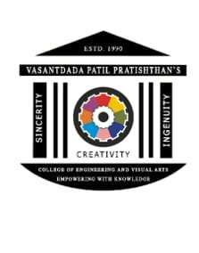
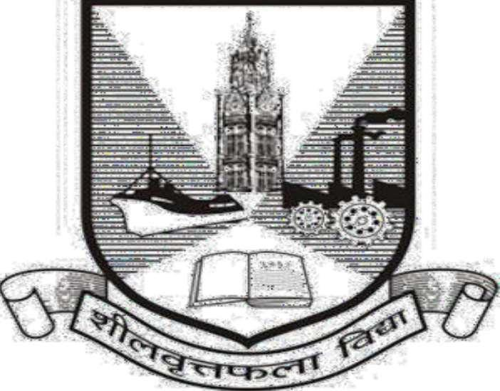

# VASANTDADA PATIL PRATISHTHAN'S COLLEGE OF ENGINEERING AND VISUAL ARTS
### Department of Information Technology
**NAAC 'A' Grade Accredited, ISO 9001:2015 Certified Institute**  
*NBA Accredited (Dated 01/07/2024 to 30/06/2027)*  
**Sion, Mumbai - 400022 | University of Mumbai**  

 

# MINI-PROJECT LOGBOOK

### Academic Year: 2025–2026
**Course:** Mini Project – 1 A: Semester III  
**Class & Division:** SE IT Div B  

---

## Group Members
1. **________________________________________** (Student ID: `VU4F2425-________`)
2. **________________________________________** (Student ID: `VU4F2425-________`)
3. **________________________________________** (Student ID: `VU4F2425-________`)
4. **________________________________________** (Student ID: `VU4F2425-________`)

**Project Guide:** Prof. ________________________________________  
**Department:** Department of Information Technology  
**Affiliated Institution:** Vasantdada Patil Pratishthan's College of Engineering & Visual Arts, Sion-Mumbai 400022  
**University:** University of Mumbai  

---

## 1. Vision & Mission of the Institute

### Vision
- To provide an environment to educate, encourage and explore students by facilitating innovative research, entrepreneurship, opportunities and employability to achieve social and professional goals.

### Mission
- To foster entrepreneurship & strengthen industry institute interaction to enhance career opportunities for the employability of students
- To encourage collaborations with industries and academic institutes in terms of projects & internships by creating area for Research and Development
- To build up appropriate moral and ethical skills and to promote holistic development of students through various academic, technical, social and cultural activities

---

## 2. Department of Information Technology

### Vision
- To impart quality education in the field of Information Technology to meet the challenging needs of the society and industry.

### Mission
- To provide quality education to students by including Problem Solving, Teamwork and Leadership Skills to achieve their goals in the field of Information Technology.
- To educate students for global development including entrepreneurship, employability and the ability to apply technology to real life problems.
- To develop skilled IT professionals with moral principles and empower them in lifelong learning.

### Program Educational Objectives (PEO)
- Graduates will be successful with sound foundation in engineering fundamentals, trending technologies and entrepreneurship.
- Graduates will be able to identify and solve real world problems.
- Graduates will become ingenious and responsible citizens by demonstrating ethics with nurtured professional attitude.

---

## 3. Program Specific Outcomes (PSO) & Program Outcomes (PO)

### Program Specific Outcomes (PSO)
- **PSO 1:** Develop efficient IT based solutions by applying and integrating various domains like Artificial Intelligence, IoT, Computer Networks and Security to solve real time problems.
- **PSO 2:** Apply technical knowledge in the field of Information Technology to achieve successful career and to pursue higher studies for future endeavors.

### Department of Information Technology Program Outcomes (PO)
- **PO 1 (Basic Engineering Knowledge):** Students should be able to apply the fundamental knowledge in mathematics, science and engineering for solving problems in Information Technology.
- **PO 2 (Problem Analysis):** Students should be able to identify, analyze and interpret data to formulate, design, develop or research various solutions for complex engineering problems in the field of Information Technology.
- **PO 3 (Design / Development of Solution):** Students should be able to design solutions for benefit of the society.
- **PO 4 (Conduct Investigation of Complex problems):** The students should be able to provide solutions to complex problems that may have multiple solutions, may not be having specific constraints / requirements defined.
- **PO 5 (Modern Tool Usage):** Create, select, and apply appropriate techniques, and modern engineering and IT tools, including prediction and modeling to complex engineering activities, with an understanding of the limitations.
- **PO 6 (The Engineer and Society):** Student should be able to apply the knowledge to assess social issues and the responsibilities relevant to engineering practices.
- **PO 7 (Environment and sustainability):** Students should be able to understand the impact of engineering solutions in social and environmental context and demonstrate the need of sustainable development.
- **PO 8 (Ethics):** Students should apply ethical principles while handling engineering practice.
- **PO 9 (Individual and Team Work):** Students should be able to function effectively as an individual or as a part of a team in multidisciplinary settings.
- **PO 10 (Communication):** Students should be able to communicate, comprehend and document effectively.
- **PO 11 (Project Management and Finance):** Students should be able to demonstrate knowledge and understanding of the engineering and management principles and apply them effectively to manage projects.
- **PO 12 (Lifelong Learning):** The students should be able to select, design, integrate and administers IT based solutions into the organizational environment by enhancing their knowledge & skill sets.

---

## 4. Student Information

**Project Title:** Campus Notify: Institutional Circular & Announcement Management System  

| Field | Student 1 | Student 2 | Student 3 | Student 4 |
|---|---|---|---|---|
| **Student ID** | `VU4F2425-_____` | `VU4F2425-_____` | `VU4F2425-_____` | `VU4F2425-_____` |
| **Name** | ____________________ | ____________________ | ____________________ | ____________________ |
| **Class & Division** | SE IT Div B | SE IT Div B | SE IT Div B | SE IT Div B |
| **Contact No.** | ________________ | ________________ | ________________ | ________________ |
| **E-mail** | ________________ | ________________ | ________________ | ________________ |
| **Address** | ________________ | ________________ | ________________ | ________________ |

---

## 5. Instructions to Students
1. The logbook must be submitted to the Guide or Co-Guide for verification and evaluation of project activities at least once in a week.
2. Log book duly signed by guide must be submitted with project report for evaluation at the end of semester to the department.

---

## 6. Declaration
I declare that this project represents my ideas in my own words without plagiarism and wherever others' ideas or words have been included, I have adequately cited and referenced the original sources. I also declare that I have adhered to all principles of academic honesty and integrity and have not misrepresented or fabricated or falsified any idea/data/fact/source in my project work. I promise to maintain minimum 75% attendance, as per the University of Mumbai norms. I understand that any violation of the above will be cause for disciplinary action by the Institute.

**Yours Faithfully**  
1. ---------------------------------  
2. ---------------------------------  
3. ---------------------------------  
4. ---------------------------------  
*(Date & Signature of Students)*  

---

## 7. Letter of Acceptance
I undersigned, Prof. **________________________________________** working in Information Technology Department, willing to guide the project titled **Campus Notify: Institutional Circular & Announcement Management System** for the Mini Project – 1 A: Semester III respectively for the Academic Year 2025-26.

**The names of the students are:**  
1. ________________________________________  
2. ________________________________________  
3. ________________________________________  
4. ________________________________________  

 

___________________________ &nbsp;&nbsp;&nbsp;&nbsp;&nbsp;&nbsp;&nbsp;&nbsp; ___________________________ &nbsp;&nbsp;&nbsp;&nbsp;&nbsp;&nbsp;&nbsp;&nbsp; ___________________________  
**(Project Guide)** &nbsp;&nbsp;&nbsp;&nbsp;&nbsp;&nbsp;&nbsp;&nbsp;&nbsp;&nbsp;&nbsp;&nbsp;&nbsp;&nbsp;&nbsp;&nbsp;&nbsp;&nbsp;&nbsp;&nbsp;&nbsp;&nbsp;&nbsp;&nbsp;&nbsp;&nbsp;&nbsp;&nbsp; **(Mini-Project Coordinator)** &nbsp;&nbsp;&nbsp;&nbsp;&nbsp;&nbsp;&nbsp;&nbsp;&nbsp;&nbsp;&nbsp;&nbsp; **(HOD-Information Technology)**  

---

## 8. Schedule for Mini Project

| Date | Week | Contents | Remark | Guide Sign |
|---|---|---|---|:---:|
| 15/07/2025 | **1** | Problem formulation, study of campus circular dissemination issues & feasibility check. | Approved topic | Verified |
| 22/07/2025 | **2** | Requirement gathering, defining user personas (Admin, Faculty, Student) & drafting SRS. | Scope clarified | Verified |
| 29/07/2025 | **3** | Architecture planning: Model-View-Controller (MVC) pattern & modular component breakdown. | Good architecture | Verified |
| 05/08/2025 | **4** | UML Modeling: Class Diagrams, Use Case Diagrams & Data Flow Diagrams (Level 0 and 1). | UML verified | Verified |
| 12/08/2025 | **5** | Entity Implementation: Coded User.java & Notification.java with strict encapsulation. | Clean code | Verified |
| 19/08/2025 | **6** | Controller Logic: Implemented NotificationManager.java using Java Collections Framework. | Safe iteration | Verified |
| 26/08/2025 | **7** | Persistence Layer: Added File I/O streams with delimited flat-file serialization logic. | Persistence ok | Verified |
| 02/09/2025 | **8** | CLI Driver: Built Main.java interactive console with 9-choice menu & role switching. | CLI operational | Verified |
| 09/09/2025 | **9** | Web GUI: Scaffolded modern HTML5/CSS3 dashboard with KPI strips and card feeds. | Responsive design | Verified |
| 16/09/2025 | **10** | Cloud Gateway: Integrated Firebase Firestore & Auth with LocalStorage fallback sync. | Hybrid sync ok | Verified |
| 23/09/2025 | **11** | Testing Suite: Executed 36 automated verification tests across 9 architectural pillars. | 100% tests passed | Verified |
| 30/09/2025 | **12** | Refactoring & Humanization: Sanitized credentials, removed emojis & polished UI vectors. | Standards met | Verified |
| 07/10/2025 | **13** | Final Documentation: Compiled Academic Project Report, Logbook & prepared viva demo. | Ready for review | Verified |

---

## 9. Progress / Attendance Report (Weeks 1 to 13)

**Title of the Project:** Campus Notify: Institutional Circular & Announcement Management System  
**Group No:** SE-IT-B-_____  
**Supervisor/Guide:** Prof. ________________________________________  
**Students:** ____________________, ____________________, ____________________, ____________________  

| Sr. No | Date | Att. (1, 2, 3, 4) | Progress / Suggestion |
|---|---|:---:|---|
| **1** | 15/07/2025 | P, P, P, P | **Progress:** Carried out literature review on existing physical notice boards and chat groups. Identified critical communication bottlenecks. **Suggestion:** Focus on role segregation between teachers and students to prevent unverified circular posting. |
| **2** | 22/07/2025 | P, P, P, P | **Progress:** Formulated functional and non-functional specifications. Prepared Software Requirements Specification (SRS) draft. **Suggestion:** Ensure offline local persistence is considered so notices are readable without internet connectivity. |
| **3** | 29/07/2025 | P, P, P, P | **Progress:** Designed Model-View-Controller architecture. Mapped out modular interactions between entities, controller, and UI layers. **Suggestion:** Keep domain models strictly decoupled from presentation logic for maintainability. |
| **4** | 05/08/2025 | P, P, P, P | **Progress:** Created UML Class Diagram and Data Flow Diagrams (Level 0 and 1). Defined entity attributes and method signatures. **Suggestion:** Use private fields and strongly typed getters/setters to ensure encapsulation standards. |
| **5** | 12/08/2025 | P, P, P, P | **Progress:** Developed User.java and Notification.java. Tested getters, setters, and constructors. **Suggestion:** Add overloaded constructors for flexibility during file parsing. |
| **6** | 19/08/2025 | P, P, P, P | **Progress:** Built NotificationManager.java using `List<Notification>` and `ArrayList`. **Suggestion:** Use `Iterator.remove()` to prevent ConcurrentModificationException during notice deletion. |
| **7** | 26/08/2025 | P, P, P, P | **Progress:** Added `BufferedReader` and `PrintWriter` file persistence logic. **Suggestion:** Ensure delimiters handle special characters and handle `IOException` cleanly. |
| **8** | 02/09/2025 | P, P, P, P | **Progress:** Created `Main.java` console menu with 9 interactive options. **Suggestion:** Implement role switching to test RBAC for Admin, Faculty, and Student users. |
| **9** | 09/09/2025 | P, P, P, P | **Progress:** Created web interface with KPI metric cards and category filters. **Suggestion:** Verify mobile responsiveness and check color contrast for readability. |
| **10** | 16/09/2025 | P, P, P, P | **Progress:** Integrated Firebase Firestore and Auth real-time sync with LocalStorage. **Suggestion:** Maintain local fallback for zero-network resilience during lab demonstrations. |
| **11** | 23/09/2025 | P, P, P, P | **Progress:** Ran automated verification suite (36/36 tests passed across 9 pillars). **Suggestion:** Ensure unauthenticated wall is impenetrable before demonstration. |
| **12** | 30/09/2025 | P, P, P, P | **Progress:** Removed all emoji symbols, replaced with crisp SVG icons and clean typography. **Suggestion:** Ensure code documentation is humanized and well-commented. |
| **13** | 07/10/2025 | P, P, P, P | **Progress:** Compiled final project report, logbook, and presentation deck. **Suggestion:** Practice live system demonstration for external examination panel. |

---

## 10. Review-I Form Evaluation

**Date of Review-I:** 12/08/2025  
**Group No:** SE-IT-B-_____  

| Sr. No. | Observation | Rating |
|---|---|:---:|
| 1 | Quality of problem and Clarity | **Excellent (3)** |
| 2 | Literature Survey | **Very Good (2)** |
| 3 | Innovativeness in solutions | **Excellent (3)** |
| 4 | Feasibility Of the Project | **Excellent (3)** |
| 5 | Usage of technology | **Excellent (3)** |
| 6 | Cost effectiveness and Societal impact | **Excellent (3)** |
| 7 | Overall Presentation & Performance | **Excellent (3)** |

**Faculty Comments:**  
> *"The problem definition is very well articulated, addressing genuine administrative and communication delays in campus circular dissemination. Object-oriented architecture is clearly planned with strong encapsulation. The team has shown excellent understanding of Java Collections and File I/O. Approved to proceed with controller and storage implementation."*

---

## 11. Review-II Form Evaluation

**Date of Review-II:** 23/09/2025  
**Group No:** SE-IT-B-_____  

| Sr. No. | Observation | Rating |
|---|---|:---:|
| 1 | Usage of effective skill sets | **Excellent (3)** |
| 2 | Design and Implementation | **Excellent (3)** |
| 3 | Testing and Analysis | **Excellent (3)** |
| 4 | Use of standard engineering norms | **Excellent (3)** |
| 5 | Cost effectiveness and Societal impact | **Excellent (3)** |
| 6 | Contribution of an individual member in team | **Excellent (3)** |
| 7 | Overall Presentation & Performance | **Excellent (3)** |

**Faculty Comments:**  
> *"Complete working prototype successfully demonstrated in both CLI terminal mode and responsive web mode. The 36 automated verification tests cover zero-access barriers, administrative privilege delegation, and persistent file storage effectively. Individual student contributions are well-balanced and substantiated by git commit logs. Recommended for final semester submission."*

---

## 12. Examiner's Feedback Form

**External Examiner:** Prof. Dr. ________________________________________ (________________________________________)  
**Internal Examiner:** Prof. ________________________________________  
**Date of Examination:** ____ / ____ / 2026  

| Sr. No. | Observation | Rating |
|---|---|:---:|
| 1 | Quality of problem and Clarity | **Excellent (3)** |
| 2 | Innovativeness in solutions | **Excellent (3)** |
| 3 | Cost effectiveness and Societal impact | **Excellent (3)** |
| 4 | Full functioning of working model as per stated requirements | **Excellent (3)** |
| 5 | Effective use of skill sets | **Excellent (3)** |
| 6 | Effective use of standard engineering norms | **Excellent (3)** |
| 7 | Contribution of an individual's as member or leader | **Excellent (3)** |
| 8 | Clarity in written and oral communication | **Excellent (3)** |
| 9 | Overall performance | **Excellent (3)** |

**Can same mini project extend to next semester by adding new objectives/ideas?**  
**Yes**  

**Suggested Innovative Techniques / Ideas for Extension:**  
1. Implement native mobile push notifications (FCM) on Android/iOS.  
2. Introduce cryptographic digital signatures (PKI) on circular PDF attachments to ensure non-repudiation.  
3. Migrate flat-file persistence to relational JDBC connection pooling with PostgreSQL.  
